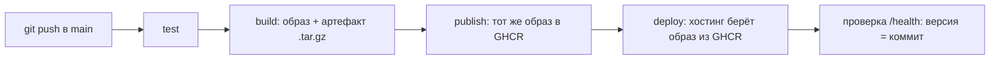

# Домашнее задание 1 — приложение в контейнере, CI/CD и мониторинг

Учебное веб-приложение «Заметки» (Flask + SQLite): заметки можно добавлять,
изменять и удалять прямо в браузере. Содержимое не важно — важен процесс
вокруг него: сборка, артефакт, контейнер, деплой, мониторинг.

## Ссылки

| Что | Где |
|---|---|
| Работающее приложение | `<ссылка на приложение>` |
| Страница статуса и метрик | `<ссылка на приложение>/status` |
| Метрики Prometheus | `<ссылка на приложение>/metrics` |
| Health check | `<ссылка на приложение>/health` |
| Исходный код | https://github.com/ProstoDobr/Homework_1_Chau |
| Pipeline (Actions) | https://github.com/ProstoDobr/Homework_1_Chau/actions |

## Что в репозитории

```
app/                         исходный код приложения (Flask)
tests/                       тесты
Dockerfile                   описание контейнера
docker-compose.yml           приложение + Prometheus + Grafana
monitoring/                  конфиг Prometheus, источник данных и дашборд Grafana
scripts/build.sh             сборка образа и сохранение артефакта (.tar.gz)
scripts/deploy.sh            развёртывание из артефакта
scripts/run_local.sh         запуск всего стека одной командой
scripts/wait_health.sh       ожидание успешного health check
.github/workflows/ci-cd.yml  CI/CD pipeline
```

## Как запустить (для проверяющего)

Нужны только Docker и Docker Compose.

```bash
git clone https://github.com/ProstoDobr/Homework_1_Chau.git
cd Homework_1_Chau
./scripts/run_local.sh
```

Скрипт собирает образ, поднимает приложение с мониторингом и ждёт успешного
health check. После этого:

| | Адрес |
|---|---|
| Приложение | http://localhost:8000 |
| Статус и метрики (удобная страница) | http://localhost:8000/status |
| Метрики в формате Prometheus | http://localhost:8000/metrics |
| Prometheus | http://localhost:9090 |
| Grafana (дашборд открывается сразу) | http://localhost:3000 |

Остановить: `docker compose down` (вместе с данными: `docker compose down -v`).

Тесты без Docker: `pip install -r app/requirements.txt`, затем
`python -m unittest discover -s tests -v` (Python 3.12).

## CI/CD



Pipeline описан в `.github/workflows/ci-cd.yml` и запускается при push в `main`
(для pull request выполняются только `test` и `build`).

1. **test** — запускает тесты приложения.
2. **build** — `scripts/build.sh` собирает образ по `Dockerfile` (в него
   записывается хеш коммита) и сохраняет его как файл `artifacts/*.tar.gz`
   (`docker save`). Затем контейнер запускается, и проверяется `/health`.
   Файл загружается как артефакт сборки (Actions → запуск → Artifacts).
3. **publish** — скачивает этот артефакт, загружает образ (`docker load`) и
   публикует его в GitHub Container Registry с тегами `<хеш коммита>` и `latest`.
   Образ не пересобирается: в registry попадает ровно то, что было проверено.
4. **deploy** — запрашивает у хостинга деплой образа с тегом текущего коммита и
   ждёт, пока `/health` по ссылке приложения не вернёт версию этого коммита.
   Так pipeline сам подтверждает, что развернулась именно новая сборка.

Сборка и деплой без GitHub Actions выполняются теми же скриптами:

```bash
./scripts/build.sh                                  # образ + artifacts/homework1-app-<коммит>.tar.gz
scp artifacts/*.tar.gz user@server:/opt/hw1/        # перенос на сервер
# на сервере, в каталоге с репозиторием:
./scripts/deploy.sh /opt/hw1/homework1-app-<коммит>.tar.gz
```

`deploy.sh` загружает образ из артефакта и запускает стек. Заметки лежат на
volume `app-data`, поэтому при обновлении версии данные не теряются.

## Мониторинг

Приложение само отдаёт метрики на `/metrics`, Prometheus собирает их каждые
15 секунд, Grafana показывает готовый дашборд «Homework 1 — Заметки»
(создаётся автоматически из `monitoring/grafana/`).

| Требование | Метрика | Где смотреть |
|---|---|---|
| Ресурсы потребляемые | `app_container_memory_usage_bytes`, `app_container_cpu_usage_seconds_total` | дашборд, `/status` |
| Ресурсы доступные | `app_container_memory_limit_bytes`, `app_container_cpu_limit_cores`, `app_host_memory_available_bytes`, `app_disk_free_bytes` | дашборд, `/status` |
| Health check | `/health` (200 или 503), `up{job="app"}` в Prometheus, `HEALTHCHECK` в Dockerfile | `/health`, дашборд |
| Посещения в час | `app_visits_last_hour`, `app_visits_last_24h` | дашборд, `/status` (таблица по часам) |

Посещением считается открытие главной страницы `/`. Запросы к `/health`,
`/metrics` и `/status` в счётчик не попадают, иначе health check
(раз в 15 секунд) искажал бы статистику. Посещения хранятся в той же SQLite-базе
(7 суток), поэтому счётчик не зависит от числа процессов и переживает перезапуск.

Память и CPU контейнера читаются из cgroup (`/sys/fs/cgroup`), поэтому
отдельные экспортёры не нужны и стек запускается одинаково на Linux, macOS и Windows.

## Настройка деплоя

Хостинг — [Render](https://render.com), бесплатный тариф: веб-сервис из готового
Docker-образа. Подойдёт и другая платформа, которая умеет брать образ из
registry по webhook.

1. GitHub: Settings → Packages → пакет `homework_1_chau` → Package settings →
   Change visibility → **Public** (иначе хостинг не скачает образ).
2. Render: New → Web Service → Existing Image →
   `ghcr.io/prostodobr/homework_1_chau:latest`, тариф Free,
   Health Check Path: `/health`.
3. Скопировать Deploy Hook из настроек сервиса.
4. GitHub: Settings → Secrets and variables → Actions: секрет
   `RENDER_DEPLOY_HOOK` — адрес хука; переменная `APP_URL` — адрес сервиса,
   например `https://hw1.onrender.com` (без слеша в конце).

После этого каждый push в `main` автоматически обновляет работающее приложение.

Ограничения бесплатного тарифа: сервис засыпает без обращений и просыпается
около минуты; файловая система временная, поэтому заметки и счётчик посещений
на хостинге сбрасываются при каждом новом деплое. При локальном запуске через
`docker compose` данные хранятся на volume и сохраняются.
